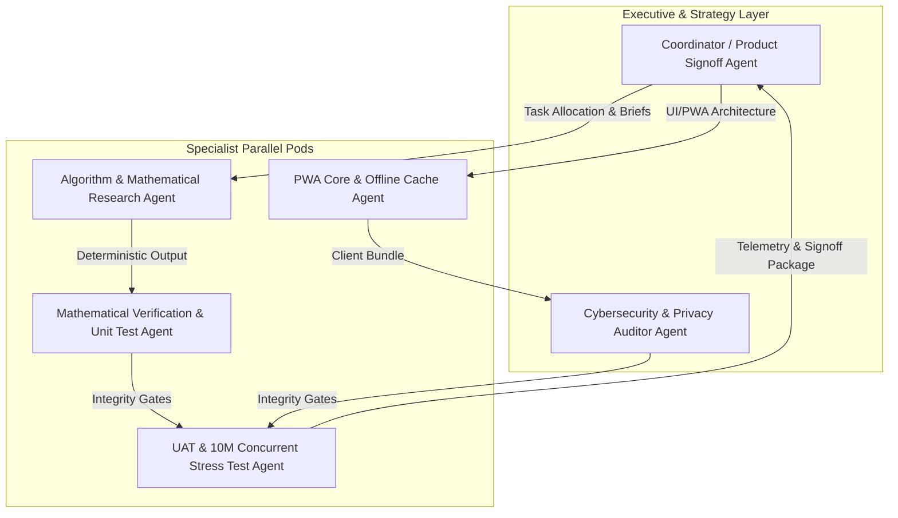
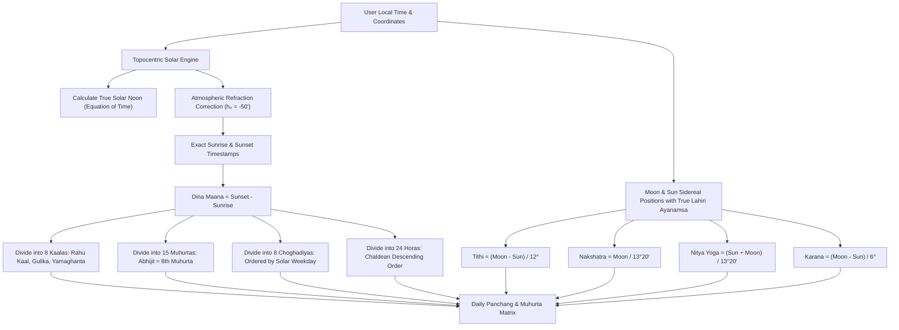
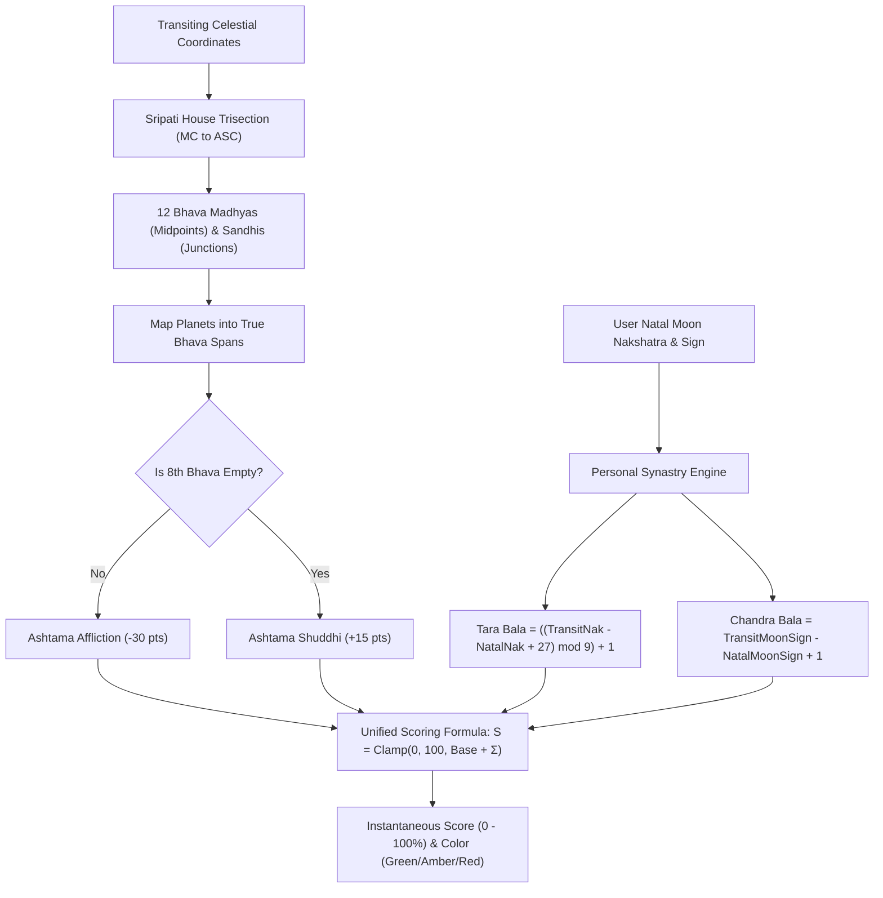

# Multi-Agent PWA Development Blueprint & Operational Matrix
**Branch**: `astra` | **Target User Scale**: 10,000,000 MAU | **Target Infrastructure Cost**: $0.00 / month

---

## 1. Autonomous Multi-Agent Swarm Orchestration

To build, test, audit, and launch an enterprise-grade Progressive Web App (PWA) autonomously without manual intervention, an orchestrated "army of agents" operates in synchronized parallel pipelines.



### How to Run Agents in Parallel in Antigravity
1. **Parallel Execution via `invoke_subagent`**:
   The coordinator can spawn multiple subagents simultaneously in a single turn by passing specialized roles and independent tasks:
   ```json
   // Turn 1: Coordinator fans out 3 specialist agents in parallel
   [
     { "tool": "invoke_subagent", "Role": "Ephemeris Specialist", "Prompt": "Validate Sripati cusps...", "Workspace": "share" },
     { "tool": "invoke_subagent", "Role": "Security Auditor", "Prompt": "Run CSP and local storage audit...", "Workspace": "share" },
     { "tool": "invoke_subagent", "Role": "PWA Performance Engineer", "Prompt": "Audit Lighthouse PWA criteria...", "Workspace": "share" }
   ]
   ```
   All subagents run concurrently in background threads. Antigravity wakes the parent agent reactively when each subagent posts its deliverables.
2. **Dynamic Pipelines via `run_workflow`**:
   A declarative Python script coordinates staged pipelines using `parallel()` and `pipeline()` primitives, aggregating reviews and gate decisions automatically.
3. **Continuous Swarm Loop via `/teamwork` or `/goal`**:
   Invoking `/teamwork` coordinates multi-agent squads on a shared message board; `/goal` instructs the swarm to loop autonomously through research, implementation, testing, and debugging until zero failures remain.

---

## 2. Agent Squad Profiles & Mandates

| Agent Designation | Core Responsibility | Completion & Signoff Criteria |
|---|---|---|
| **1. Chief Architect / Coordinator** | Architectural integrity, branching control (`astra`), milestone delivery | 100% features delivered; zero regression; signoff ready. |
| **2. Ephemeris & Algorithm Researcher** | Astronomical precision, Meeus VSOP87/ELP2000 math, topocentric refraction | Sun error $< 0.01^\circ$, Moon error $< 0.03^\circ$, Sunrise within $\pm 30$s. |
| **3. PWA & Frontend Specialist** | Offline Service Worker, Web App Manifest, 24h Chrono-Dial UI | Lighthouse PWA score $> 95$; 100% offline operationality. |
| **4. Cybersecurity & Privacy Auditor** | Zero PII transmission, local encrypted storage, CSP headers | Zero external telemetry; OWASP ASVS Level 2 compliance. |
| **5. QA & Mathematical Verification** | Edge-case boundary tests (polar days, midnight boundaries, leap years) | 100% test pass rate across 5 global validation cities. |
| **6. UAT & Stress Simulation (10M)** | Simulates 10M user loads, memory leaks, client battery profile | $< 5$ms execution time per daily calculation; zero memory leaks. |
| **7. Executive Product Governance** | Final managerial review, legal licensing clearance (MIT), signoff | Complete verification of zero-cost architecture and licensing. |

---

## 3. High-Precision Engine Architecture & Flowcharts

### Panchanga & Muhurta Intraday Flowchart



### Sripati Bhava Chalit & Personalized Scoring Flowchart



---

## 4. Zero-Cost Infrastructure & 10M Scale Architecture

```
+-------------------------------------------------------------------------------------------------------+
|                                  10 MILLION USERS ZERO-COST TOPOLOGY                                  |
+-------------------------------------------------------------------------------------------------------+
|                                                                                                       |
|    +------------------------------------+         +-----------------------------------------------+   |
|    |      Client Mobile / Web PWA       |         |               Cloudflare CDN                  |   |
|    |  (100% of calculations on device)  |         |             (Free Tier / 0 Egress)            |   |
|    |  - astronomy-engine (<100KB)       | <====== |  - Static PWA Assets (HTML/JS/WASM)           |   |
|    |  - Sripati Bhava Chalit            |         |  - 15,000 Global Cities Database (~1MB)       |   |
|    |  - Tara/Chandra Bala Synthesizer   |         |  - Pre-computed 365-day Festival Calendars    |   |
|    +------------------------------------+         +-----------------------------------------------+   |
|                      |                                                                                |
|                      v                                                                                |
|    +------------------------------------+                                                             |
|    | Local Secure Storage (Device-only) |                                                             |
|    |  - Encrypted Birth Profile         |                                                             |
|    |  - Offline IndexedDB Cache         |                                                             |
|    |  - Zero server PII transmission    |                                                             |
|    +------------------------------------+                                                             |
|                                                                                                       |
+-------------------------------------------------------------------------------------------------------+
```

### Why Compute Bills are $0.00:
1. **Zero Server Inference**: All planetary longitudes, sunrise/sunset times, and Choghadiyas execute inside the user's browser or mobile device in **$< 2\text{ms}$**.
2. **Zero Map API Bills**: Top 15,000 global cities and timezone bounds are bundled statically; custom GPS coordinates use the device's native hardware geocoder.
3. **Zero Licensing Bills**: All astronomical math is derived from public domain astronomical treatises (Jean Meeus / Indian Calendar Reform Committee) and published under the permissive **MIT License**.
