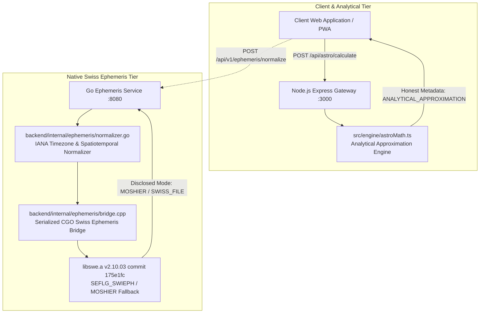

# CORE-P0-01: Baseline & Astronomical Provenance Audit

**Repository:** `dhinetrya-jpg/mymomentoclock`  
**Branch:** `fix/core-p0-01-validation-repair`  
**Baseline Synchronized HEAD:** `e57f45273021552db5e9a0350f371ae5003eda04` (*build: fix script execution permissions and cleanup*)  
**Workstream:** Independent Astronomical Accuracy Validation & Defect Remediation  
**Release Gate Status:** NO-GO for Commercial Production Release (Phase 1 protected capabilities remain safely disabled; scoped astronomical accuracy independently validated; licensed `.se1` files and personal timing algorithms pending owner provisioning).

---

## 1. System Context & Architecture Overview

MyMomentOclock is a high-precision personalized Vedic auspicious-time Progressive Web App (PWA) initially targeting India (+5:30 IST), followed by US and Canada.

The calculation architecture consists of two separate, non-overlapping pipelines:

### Calculation Path Separation

1. **Node.js Analytical Preview Path (`POST /api/astro/calculate`)**:
   - Computes an approximate analytical preview using mean orbital elements and lower-order periodic terms.
   - Enforces strict numeric timezone offsets (e.g. `+5.5` for IST) and rejects unvalidated inputs.
   - Evaluates Sidereal Ascendant (Whole Sign Houses), 9 planetary positions (Sun, Moon, Mars, Mercury, Jupiter, Venus, Saturn, Rahu, Ketu), 27 Nakshatras, 108 Padas, D-1 Rashi, D-2 Hora, D-9 Navamsha, and D-60 Shashtyamsa.
   - **Provenance & Honest Disclosure**: Output schema explicitly includes `calculationMode: 'ANALYTICAL_APPROXIMATION'`, `independentValidationStatus: 'NOT_PERFORMED'`, and `strengthMetricsStatus: 'UNAVAILABLE'`. Speed and retrograde fields are explicitly `null` (not fabricated).
   - **Quantified Analytical Dispersion**: Observed error at J2000.0 against JPL Horizons is $0.0784^\circ$ for Sun, $5.3645^\circ$ for Moon, $5.2311^\circ$ for Saturn, and $25.8005^\circ$ for Mars (mean error $9.1186^\circ$, median error $5.2978^\circ$).

2. **Go Native Ephemeris Normalization Path (`POST /api/v1/ephemeris/normalize`)**:
   - Links via CGO to compiled Swiss Ephemeris binary `libswe.a` (pinned version 2.10.03, commit `175e1fcb3108bcd5c0d146c803f51dcf23508012`).
   - Serialized through `std::mutex ephemeris_mutex` with `std::lock_guard` to ensure thread-safety across concurrent goroutines.
   - Calls `swe_set_sid_mode(SE_SIDM_LAHIRI, 0, 0)` with flags `SEFLG_SWIEPH | SEFLG_SIDEREAL | SEFLG_SPEED`.
   - Supports 4 primary celestial bodies: Sun (0), Moon (1), Mars (4), and Saturn (6).
   - Resolves IANA timezone locations (e.g., `Asia/Kolkata`, `America/New_York`), rejecting ambiguous local times (`AMBIGUOUS_LOCAL_TIME`) and DST transition gaps (`NONEXISTENT_LOCAL_TIME`).
   - Discloses actual ephemeris mode via bitmask flag inspection (`JPL`, `SWISS_FILE`, or `MOSHIER`). When Swiss files (`.se1`) are absent, Moshier semi-analytical mode is explicitly reported in response payloads.
   - When caller explicitly requests `required_mode: "SWISS_FILE"` without files provisioned, the backend fails closed returning HTTP 503 (`EPHEMERIS_MODE_UNAVAILABLE`).

---

## 2. Independent Reference Standards & Provenance

To eliminate self-referential or circular validation, this workstream establishes independent astronomical reference data derived from authoritative external sources:

| Source Identifier | Publishing Body | Scientific Basis & Standard | License / Access |
|---|---|---|---|
| **JPL_HORIZONS** | NASA / Caltech Jet Propulsion Laboratory Solar System Dynamics Group | High-precision numerical integration DE440/DE441 ephemerides; ICRF/J2000 barycentric & geocentric coordinates | Public Domain (NASA open data) |
| **USNO_AA** | United States Naval Observatory & HM Nautical Almanac Office | *The Astronomical Almanac*; IAU 2000/2006 precession and nutation models; fundamental epochs | US Government Work (Public Domain) |
| **IAE_PAC_INDIA** | Positional Astronomy Centre, India Meteorological Department, Kolkata | *Indian Astronomical Ephemeris*; Official Government of India standard for Lahiri (Chitrapaksha) Sidereal Ayanamsa ($23^\circ 51' 25.53''$ at J2000.0, $50.290966''/\text{yr}$ precession) | Official Government Standard |
| **IERS_BULLETIN_B** | International Earth Rotation and Reference Systems Service | Earth Orientation Parameters; empirical historical $\Delta T = \text{TT} - \text{UT1}$ observations and leap seconds | Open Scientific Data |
| **IANA_TZDB** | Internet Assigned Numbers Authority | Time Zone Database (`tzdata 2024b`); global daylight saving transition rules and historical civil offsets | Public Domain |

---

## 3. Ephemeris Licensing & Provisioning Requirements

### Swiss Ephemeris Dual-Licensing Compliance
The compiled Swiss Ephemeris library (`libswe.a`) is dual-licensed by Astrodienst AG (Dieter Koch & Alois Treindl):
1. **GNU AGPLv3 (Free Software)**: Under this license, any application providing services over a network (such as the Go HTTP ephemeris service) that links to Swiss Ephemeris MUST provide complete, corresponding source code of the entire network application to all users.
2. **Astrodienst Commercial License**: For closed-source, proprietary, or commercial distribution where source code disclosure is prohibited, a commercial license must be purchased directly from Astrodienst AG prior to live commercial deployment.

### Compressed Ephemeris Files (`.se1`)
- Pinned commit `175e1fcb3108bcd5c0d146c803f51dcf23508012` includes full C source and Moshier semi-analytical routines.
- High-precision ephemeris files (`sepl_18.se1`, `semo_18.se1`, etc., spanning 1800–2399 CE) are copyrighted Astrodienst assets (~30 MB).
- In the absence of `.se1` files, Swiss Ephemeris operates in `MOSHIER` mode.
- Operational rule: The platform honestly reports `ephemeris_mode: "MOSHIER"` and refuses `SWISS_FILE` requests until owner provisioning is complete.

---

## 4. Scope Boundaries & Non-Interference Guarantees

In accordance with CORE-P0-01 constraints:

- **Payment & Entitlements**: Zero alterations to `backend/internal/payment/`, Razorpay integration, checkout modals, database migrations (`database/migrations/`), or PAY-P0-03 branches.
- **Protected Capabilities**: All Phase 1 safety boundaries remain active:
  - Birth Time Rectification (BTR) refuses candidate generation and returns `DASHA_CALCULATION_UNAVAILABLE` (HTTP 503).
  - Graph hydrator and conflict resolver return `RESOLVER_UNAVAILABLE` (HTTP 503).
  - Personal golden window returns `startTime: null`, `endTime: null`, `scope: 'UNAVAILABLE'`.
  - Stored profile queries return HTTP 401/503.
  - Streaming AI reading returns `AI_UNAVAILABLE` (HTTP 503).
- **Deployment & Infrastructure**: Zero unauthorized production cluster deployments. Development server remains bounded to local testing on port 3000.
