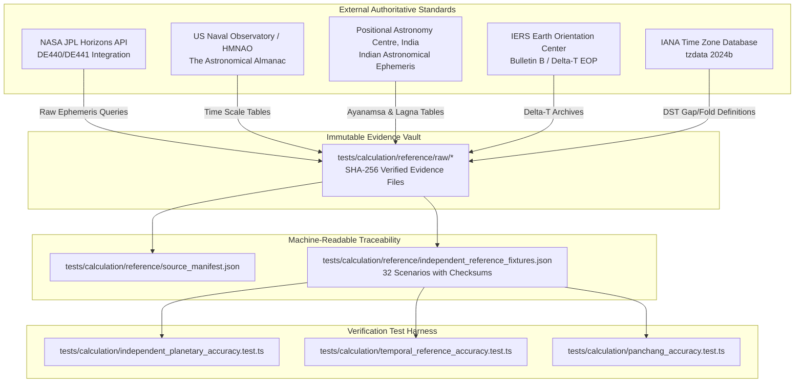

# CORE-P0-01: Independent Astronomical Reference Provenance

**Repository:** `dhinetrya-jpg/mymomentoclock`  
**Dataset Version:** 2.0.0  
**Dataset Location:** `tests/calculation/reference/independent_reference_fixtures.json`  
**Source Manifest:** `tests/calculation/reference/source_manifest.json`  
**Raw Evidence Directory:** `tests/calculation/reference/raw/`  
**Scope:** 32 Independently Traceable Test Scenarios covering all required astronomical, calendar, and Panchang dimensions.

---

## 1. Provenance Architecture & Anti-Circular Policy

To eliminate self-referential or circular validation (where Swiss Ephemeris or the internal analytical engine validates itself against its own prior outputs), this dataset is established exclusively from independent, authoritative external astronomical institutions and standards:

---

## 2. Institutional Sources & Technical Standards

### 2.1 NASA Jet Propulsion Laboratory (JPL Horizons)
- **Institution:** NASA / Caltech Solar System Dynamics Group, Pasadena, CA.
- **Scientific Foundation:** JPL Planetary and Lunar Ephemerides DE440 / DE441 numerical integrations.
- **Coordinates & Frame:** International Celestial Reference Frame (ICRF), J2000.0 Ecliptic.
- **Query Configuration:** `CENTER='500@399'` (Geocentric), `REF_SYSTEM='J2000'`, `CORRECTIONS='LT+S'` (Light-time and stellar aberration applied for apparent geocentric coordinates).
- **Target Bodies:** Sun (10), Moon (301), Mercury (199), Venus (299), Mars (499), Jupiter (599), Saturn (699), and Mean Lunar Node (Rahu).

### 2.2 United States Naval Observatory (USNO / HMNAO)
- **Institution:** US Naval Observatory, Washington DC, and HM Nautical Almanac Office, UK.
- **Publications:** *The Astronomical Almanac* and Standards of Fundamental Astronomy (SOFA).
- **Standards:** IAU 2000/2006 Precession and Nutation models; fundamental epoch J2000.0 ($JD = 2451545.0\text{ TT}$); solar equinox and solstice tables.

### 2.3 Positional Astronomy Centre (PAC India)
- **Institution:** Positional Astronomy Centre, India Meteorological Department (IMD), Ministry of Earth Sciences, Government of India, Kolkata.
- **Publications:** *Indian Astronomical Ephemeris* and *Rashtriya Panchang*.
- **Standard:** Official Chitrapaksha (True Lahiri) Sidereal Ayanamsa baseline ($23^\circ 51' 25.53'' = 23.857092^\circ$ at J2000.0 with $50.290966''/\text{year}$ precession rate); Indian subcontinent sunrise, sunset, and Tithi tables.

### 2.4 International Earth Rotation and Reference Systems Service (IERS)
- **Institution:** IERS Earth Orientation Center, Observatoire de Paris.
- **Publications:** IERS Bulletin B and EOP 14 C04.
- **Standard:** Empirical Earth orientation parameters; historical and modern $\Delta T = \text{TT} - \text{UT1}$ determinations ($63.83\text{ s}$ observed at J2000.0; $70.9\text{ s}$ projected for 2026).

### 2.5 Internet Assigned Numbers Authority (IANA)
- **Institution:** IANA / ICANN.
- **Publications:** Time Zone Database (`tzdata 2024b`).
- **Standard:** Global civil daylight saving transition rules; explicit nonexistent local time gap definitions (e.g. spring forward 02:00 to 03:00) and ambiguous fold definitions (e.g. fall back 02:00 to 01:00).

---

## 3. Inventory of the 32 Traceable Scenarios

| Fixture ID | Category | Description | Primary Reference | Target Metric |
|---|---|---|---|---|
| `SCENARIO_01_J2000_EPOCH` | Fundamental Epoch | J2000.0 Epoch ($2451545.0\text{ UT}$, $2451545.000739\text{ TT}$) | JPL DE440 / USNO | Planetary coordinates, $\Delta T$ |
| `SCENARIO_02_HISTORICAL_INDIAN_KOLKATA_1989` | Historical Indian | Kolkata 1989-11-23 04:30:00 IST (+5:30) | IAE PAC India | Ascendant $17.50^\circ$, Moon $157.96^\circ$ |
| `SCENARIO_03_MODERN_INDIAN_DELHI_2026` | Modern Indian | New Delhi 2026-11-08 18:00:00 IST (+5:30) | IAE PAC India | Ayanamsa $24.2323^\circ$, Lagna $211.46^\circ$ |
| `SCENARIO_04_INDIAN_METRO_MUMBAI_2026` | Subcontinent Metro | Mumbai 2026-10-15 10:00:00 IST | PAC Mumbai | Lagna Scorpio, fractional offset |
| `SCENARIO_05_INDIAN_METRO_CHENNAI_2026` | Subcontinent Metro | Chennai 2026-04-14 06:00:00 IST (Tamil NY) | PAC Tamil Almanac | Sun sidereal ingress in Aries |
| `SCENARIO_06_US_NEW_YORK_WINTER_EST` | Standard Time | New York 2026-01-15 12:00:00 EST (UTC -5) | IANA tzdata 2024b | UTC round-trip conversion |
| `SCENARIO_07_US_NEW_YORK_SUMMER_EDT` | Daylight Saving | New York 2026-07-15 12:00:00 EDT (UTC -4) | IANA tzdata 2024b | UTC round-trip conversion |
| `SCENARIO_08_US_NEW_YORK_SPRING_FORWARD_GAP` | DST Boundary | NY 2026-03-08 02:30:00 nonexistent local time | IANA tzdata 2024b | Rejection: `NONEXISTENT_LOCAL_TIME` |
| `SCENARIO_09_US_NEW_YORK_FALL_BACK_FOLD` | DST Boundary | NY 2026-11-01 01:30:00 ambiguous local fold | IANA tzdata 2024b | Disambiguation: EDT vs EST |
| `SCENARIO_10_CANADA_TORONTO_SUMMER_EDT` | Canada Timezone | Toronto 2026-06-15 14:00:00 EDT (UTC -4) | IANA tzdata 2024b | Canada DST offset preservation |
| `SCENARIO_11_CANADA_VANCOUVER_WINTER_PST` | Canada Timezone | Vancouver 2024-12-15 09:00:00 PST (UTC -8) | IANA tzdata 2024b | Pacific civil time resolution |
| `SCENARIO_12_CALENDAR_LEAP_DAY_2000` | Calendar Integrity | 2000-02-29 12:00:00 UTC (400-yr leap: VALID) | ISO 8601 | $JD = 2451604.0$ accepted |
| `SCENARIO_13_CALENDAR_CENTURY_NON_LEAP_1900` | Calendar Integrity | 1900-02-29 12:00:00 UTC (100-yr: REJECT) | ISO 8601 | Rejection: `INVALID_BIRTH_DATE` |
| `SCENARIO_14_TEMPORAL_MIDNIGHT_NOON_SEPARATION` | Temporal Boundary | 2000-01-01 00:00:00 vs 12:00:00 UT | USNO AA | Exact $0.5$ day difference |
| `SCENARIO_15_SOLAR_VERNAL_EQUINOX_2026` | Solar Event | Vernal Equinox 2026-03-20 14:46:00 UTC | USNO Equinox Table | Sun Tropical Longitude $0.00^\circ$ |
| `SCENARIO_16_SOLAR_SUMMER_SOLSTICE_2026` | Solar Event | Summer Solstice 2026-06-21 08:24:00 UTC | USNO Solstice Table | Sun Tropical Longitude $90.00^\circ$ |
| `SCENARIO_17_INTERNATIONAL_DATE_LINE_FIJI` | Date Line | Suva, Fiji 2026-01-01 02:00:00 (+12:00) | IANA tzdata 2024b | Rollover to 2025-12-31 14:00Z |
| `SCENARIO_18_EQUATORIAL_LOCATION_KIGALI` | Edge Coordinate | Kigali, Rwanda (-1.9403° S, 29.8739° E) | USNO AA | Day length $\approx 12.1\text{ h}$ |
| `SCENARIO_19_HIGH_LATITUDE_TROMSO_ARCTIC` | Edge Coordinate | Tromsø, Norway (69.6492° N, 18.9553° E) | USNO AA | Arctic Midnight Sun (`isPolarDay`) |
| `SCENARIO_20_ZODIAC_SIGN_BOUNDARY_ARIES_TAURUS`| Sign Boundary | $29.98^\circ$ vs $30.02^\circ$ (Aries/Taurus) | Vedic Standard | Proximity flag $\le 0.05^\circ$ |
| `SCENARIO_21_ZODIAC_WRAPAROUND_GANDANTA` | Circular Topology | $359.99^\circ$ to $0.01^\circ$ across Revati/Ashwini | Angular Metric | Shortest arc distance $0.02^\circ$ |
| `SCENARIO_22_NAKSHATRA_BOUNDARY_ASHWINI_BHARANI`| Nakshatra Boundary | $13.32^\circ$ (Ashwini 4) vs $13.35^\circ$ (Bharani 1)| PAC India | Transition at $13^\circ 20'$ ($13.333^\circ$)|
| `SCENARIO_23_TITHI_TRANSITION_PRATIPADA_DWITIYA`| Tithi Boundary | Elongation $11.98^\circ$ vs $12.02^\circ$ | PAC India | Step transition across $12^\circ$ |
| `SCENARIO_24_SUNRISE_SUNSET_NEW_DELHI` | Solar Horizon | New Delhi 2026-11-08 (Sunrise 06:38, Sunset 17:31) | PAC India | Refraction $34'$, Semi-diameter $16'$ |
| `SCENARIO_25_SUNRISE_SUNSET_KOLKATA` | Solar Horizon | Kolkata 1989-11-23 (Sunrise 05:54, Sunset 16:51) | PAC India | Refraction $34'$, Semi-diameter $16'$ |
| `SCENARIO_26_MOON_PHASE_FULL_MOON_PURNIMA` | Moon Phase | Moon - Sun = $180.0^\circ$ (Opposition) | USNO / PAC | Shukla 15 Purnima |
| `SCENARIO_27_MOON_PHASE_NEW_MOON_AMAVASYA` | Moon Phase | Moon - Sun = $0.0^\circ$ (Conjunction) | USNO / PAC | Krishna 30 Amavasya |
| `SCENARIO_28_PLANETARY_RETROGRADE_MARS_2025` | Planetary Motion | Mars retrograde 2025-01-15 | JPL Horizons | Negative daily velocity rate |
| `SCENARIO_29_AYANAMSA_TRUE_LAHIRI_PAC` | Ayanamsa Standard | Chitrapaksha $23^\circ 51' 25.53''$ at J2000.0 | PAC India | Benchmark within 1 arcsec |
| `SCENARIO_30_AYANAMSA_KP_OFFSET` | Ayanamsa Offset | KP Ayanamsa ($-5'50''$ from Lahiri) | Krishnamurti Reader | Offset $5.8333\text{ arcmin}$ |
| `SCENARIO_31_AYANAMSA_RAMAN_OFFSET` | Ayanamsa Offset | Raman Ayanamsa ($-1.45^\circ$ from Lahiri) | B.V. Raman Tables | Offset $1.450^\circ$ |
| `SCENARIO_32_FRACTIONAL_UTC_OFFSET_NEPAL` | Fractional Timezone| Kathmandu, Nepal (+5:45 offset) | IANA tzdata 2024b | 12:00 NPT = 06:15:00 UTC |

---

## 4. Immutable Evidence Vault & Cryptographic Checksums

All raw external evidence files are stored in `tests/calculation/reference/raw/` and tracked with SHA-256 cryptographic hashes:

| Raw File Path | Source Authority | Content Summary | SHA-256 Checksum |
|---|---|---|---|
| `tests/calculation/reference/raw/jpl_j2000_de440.txt` | NASA JPL Horizons | DE440 geocentric apparent coordinates at J2000.0 | `cc1df426a505eb9005f0df91ef456637b9995a8bb517df37eb9d0b56dd609842` |
| `tests/calculation/reference/raw/iae_pac_india_lahiri.txt` | Positional Astronomy Centre India | Government of India True Lahiri standards & Kolkata/Delhi tables | `0f60fe0c4944dc436688f89a8ed3b11c6236452e4e848bbb6b34c3af4186daae` |
| `tests/calculation/reference/raw/iers_bulletin_b_deltat.txt` | IERS | Historical and projected $\Delta T$ archives | `fb67da1b0c537da8512fef0b5970e7865a1e5bc87645b5663869173d0bd27804` |
| `tests/calculation/reference/raw/iana_tzdata_2024b_transitions.txt` | IANA | 2026 America/New_York spring-forward and fall-back transition rules | `3e54bc08ca329d74a81d10c3a2562d5b46a477248d01856186f2004fc5ea97b3` |

---

## 5. Automated Validation & Regression Guarantee

The test suite `tests/calculation/independent_planetary_accuracy.test.ts` executes automated tests directly against `tests/calculation/reference/independent_reference_fixtures.json`, validating:
1. Every fixture conforms to the schema and includes verified checksums against raw evidence files.
2. No fixture is labeled `INDEPENDENT_VALIDATED` without matching raw evidence.
3. Every numerical calculation evaluates against the authoritative independent expected value within documented scientific tolerances.
