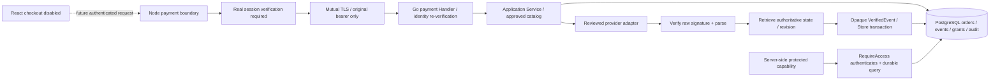

# Payment authority and trust boundaries

Go `backend/internal/payment` is the sole financial authority. Node has an authenticated mTLS forwarding adapter, not SQL or independent paid flags. React has a prepared same-origin API client and status model; checkout remains disabled. No adapter registry, test-mode environment switch or activation flag in the current executables can turn on live payments.

## Actual application wiring

- `server.ts` mounts createPaymentBoundary() with no dependencies:503. Future approved bootstrap can inject a real session verifier and createMTLSTransport. The factory refuses absent/unready identity or absent approval; the current executable supplies none. Supplied browser IDs, amount, currency, paid status and arbitrary paths are rejected.
- `backend/cmd/server/main.go` delegates payment routes through newHandlerWithPayment, defaulting to nil. A nonnil service adds database readiness checks. Public native normalization remains functional; callbacks remain503.
- `payment.Handler` requires verified client-certificate chain and configured SAN, then separately authenticates original bearer/session using Identity. No X-User-ID propagation. Ownership is in SQL predicates.
- `NewInternalServer` constructs a separate TLS1.3+ listener with RequireAndVerifyClientCert, dedicated CA, timeouts and bounded header size. It does not start it. Never serve a configured payment Handler on ordinary plaintext public HTTP; without TLS it denies all calls.
- NewService validates required DB/identity/provider/catalog, immutable catalog copy, migration readiness, namespace provider/account/environment, and explicit production approval plus adapter readiness. Only _test.go implements fixtures; production binaries have no test provider/identity.
- RequireAccess reauthenticates and checks current active, unrevoked, unexpired grants joined to COMPLETED orders, namespace and customer. Any independently valid purchase grants the capability. Existing unimplemented astrology features remain unavailable regardless of payment state.

The original bearer is sent over mTLS for Go re-verification. An alternative signed assertion was rejected because no real issuer/key/claims policy exists. A caller identity header is never a trusted substitute. mTLS trust and identity-provider trust are independent requirements.

## Order / event / recovery flow

Reserve durable CREATED order using unique(customer,idempotency_key). Persist approved product version/capability/price/currency/access-expiry snapshot before calling the provider. Retry calls use the same internal ID as provider idempotency key, outside database transactions. Bind a matching provider order and set PENDING. A lost acknowledgement can be retried; no in-memory fallback or browser price.

ProcessWebhook verifies raw bytes through a configured Provider (not generic HMAC assumptions), persists minimal verified evidence, retrieves latest authoritative state and applies that snapshot first, then the original callback. Old completion cannot grant against a known refund. Store's VerifiedEvent fields/seal are unexported: JSON cannot construct it. Only package-internal verification/reconciliation code seals evidence. Event revisions must come from an authoritative ordered provider state, never receipt time or local counters. A future adapter lacking that property must define a reviewed reconciliation mapping before activation.

Transactions lock order and event, check exact identities/values/revision, update state and one grant atomically, finish event and audit. Queue persistence intentionally precedes this transaction: a crash leaves a recoverable inbox entry, never a partial entitlement. Rejected evidence is retained as REJECTED, transient errors as RETRY; exact processed duplicates are no-ops. Conflicting reuse of event ID rejects. No raw card data or signed body is retained.

Reconcile is internal/bounded1..100, threshold>=1minute, durable lease via SKIP LOCKED, bounded evidence batch, exponential retry (cap1024minutes), audit and actual count metrics. It recovers CREATED orders with stable provider idempotency and processes pending/retry evidence only with authoritative state. Terminal orders do not reactivate. No scheduler/admin HTTP route is started. Provider outage reports failed/retry, never successful reconciliation.

## Controlled integration proof

Test-only identity/provider implementations exist solely in application_test.go. The full gate supplies Node22 to the Go test process. TestNodeGoPostgresLifecycle starts an ephemeral TLS-only Go fixture and actual Node Express boundary using actual mTLS transport, approved TEST catalog and disposable PostgreSQL. It verifies creation/retry, cross-user denial, signed test completion, one durable grant, duplicate no-op, refund and revocation. Fixture control routes are compiled only into the Go test executable; they are not server routes or environment-selectable production code.
