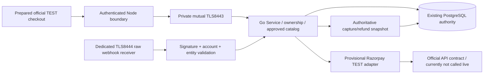

# PAY-P0-02 architecture

One authority remains Go payment Store/Application with PAY-P0-01 PostgreSQL tables. No Node financial database or browser paid flag. The provider package imports payment contracts; sandbox bootstrap imports both, avoiding cycles.

Default main still serves native normalization and unavailable payment paths. PAY_MODE=sandbox alone does not supply identity: Go FromEnvironment(nil) fails closed before reading credentials/connecting DB. Node sandbox factory without a real session adapter returns unavailable. No test identity is selected by environment; fixtures exist only in _test.go/tests. Production mode/keys are rejected.

FromEnvironment can construct approved test-mode provider, TLS PostgreSQL Store, approved catalog, injected real identity, application, dedicated internal client-CA/SAN verification and separate webhook server certificate. Main contains listener wiring and shutdown for8443 private/mTLS and8444 signature-authenticated exact webhook path, but cannot reach it with absent real identity. No ingress, external endpoint or worker is started by default. The real identity integration is an explicit remaining dependency, not a fabricated login.

Node sandbox factory prepares verified session forwarding plus existing fixed-path mTLS client. Original bearer is reverified by Go. Server order responses may include only sandbox public key/provider order ID/mode, never API/webhook secrets. Node validates/allowlists those fields and rejects live keys. A client-selected amount/currency/identity remains invalid.

Both CheckoutModal copies default to the original disabled view. Optional sandbox product presentation uses server-reserved order/price and official Razorpay widget, no custom card form. Browser callback only starts bounded server verification; durable completed order AND current own entitlement must confirm. Refund/review/reversal does not unlock. No localStorage/query authorization. Current app passes no sandbox product/identity: no SDK request occurs. CSP adds explicit provider script/frame/API sources only under requested approved sandbox config; actual SDK requirements must still be verified live.
