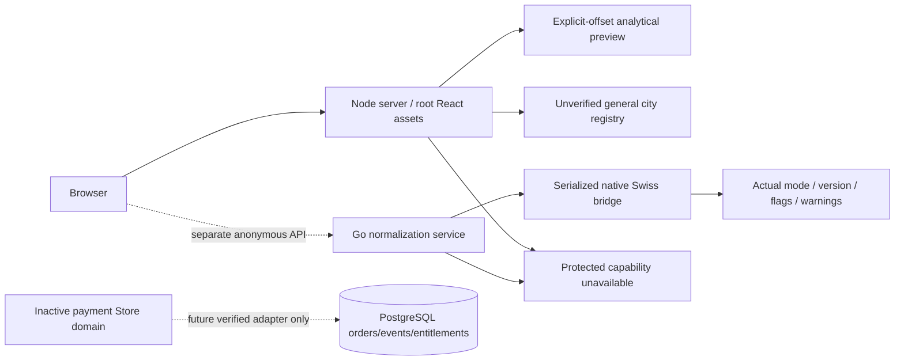

# Phase 1 final architecture

The two servers remain independent. Neither is a trusted identity provider. Protected capabilities refuse all callers. Anonymous chart input is processed statelessly. No customer profile or payment persistence is activated.

## Exposure inventory

All APIs use request IDs, no-store responses, bounded body/concurrency/rate controls and safe errors. No identity derived from query/body/header is authorized. Rate limiting is aggregate per process (600/minute), not a distributed production abuse service. Node and Go have separate limits. Request bodies and personal data are not logged by the new code.

| Service/path | Methods and boundary | Data / side effects | Verification |
|---|---|---|---|
| Node /health, /ready, /api/v1/health, /api/capabilities | GET anonymous, capabilities explicit | Process availability; no protected readiness claim | API/browser |
| Node /api/astro/calculate | POST anonymous; strict birth input, explicit numeric offset; stored IDs401 | Pure approximate chart, no persistence; schema3 unvalidated metadata |66-test suite/browser |
| Node /api/astro/rectify-btr, /api/v1/btr/rectify | POST validation then503 | No candidate, fit or certification; bounded milestones | unit/contracts/k6 |
| Node /api/astro/muhurat | GET explicit supported city only; unknown overrides422 | Static2026 general preview, natal/name independent | calculation/security/browser |
| Node /api/payment/* and /api/v1/webhook/payment | all methods503; simulate-webhook404 | No order/provider/SSE/grant/refund side effect | forged/missing-token security tests |
| Node graph/hydrate, resolver/evaluate, resolve-conflict | all methods503 | No DB/graph mutation or vectors | contracts/security |
| Node remedies, stream-reading | all methods503 | No AI/provider transfer or recommendation | privacy tests |
| Node /metrics, stress-test |404 | No diagnostics exposure | security tests |
| Node uat-test | GET test environment only;404 production | Synthetic invariant checks only | unit/security |
| Node static assets | Built dist only; historical aistudio404; unknown assets404 | public cultural/assets content; no profile data | Docker/browser |
| Go /health, /ready, /api/v1/health | GET/handler health; ready503 non-CGO | capability disclosure | route/runtime contracts |
| Go /api/v1/ephemeris/normalize | POST64KB strict decode; unknown fields422 | Four supported native bodies, no persistence; no native=>503 | Go/API/Docker |
| Go /api/v1/btr/rectify | POST strict input then503 | no candidate/certification | Go/contracts |
| Go graph/hydrate, resolver/evaluate | unavailable503 all methods | no ownership bypass or graph writes | Go/contracts |
| Go payment/*, webhook/payment | unavailable503 all methods | no fulfillment even valid primitive signature | root/backend tests/contracts |
| Go rvm/remedies |503 | no personal recommendation | route tests |
| Go other routes, metrics/stress |404 | no diagnostics | route tests |

Root Go module has no server main; exported legacy graph/BTR/resolver/webhook/AI functions also refuse execution. `frontend/src` is a duplicate build that was reconciled and compiled. Default Vite publicDir=false in both builds excludes archived aistudio source. GitHub Pages can serve a static preview only; APIs require a server host.

## Native trust boundary

Official source commit175e1fcb3108bcd5c0d146c803f51dcf23508012 (2.10.03), actual C header and static library. Native calls serialized because Swiss global configuration is shared. Actual flags checked, finite outputs validated, metadata reports MOSHIER when files absent. UTC is treated as UT and documented; no independent numerical tolerance/accuracy acceptance performed. Node analytical positions are never represented as Swiss outputs. Browser numeric offsets cannot infer historical IANA zones; Go accepts IANA tzdata and rejects ambiguous/nonexistent local times without explicit disambiguation.

## Future payment activation boundary

`backend/internal/payment.Store.CreateOrder` takes a trusted owner supplied by a future real authentication adapter and server-approved catalog, never a client price. `ApplyVerifiedEvent` takes an event already authenticated by a future selected provider verifier. The domain does NOT prove signature authenticity itself. A transaction locks the order, checks identity/value/currency/provider IDs, records a unique typed-event fingerprint and updates exactly one entitlement. Refund/reversal revokes; replay cannot regrant. Fingerprint is not a substitute for raw provider signature verification. No public route or env flag calls these methods. Live provider, identity and production DB bindings are absent.

Default Compose runs stateless loopback web/native containers with read-only filesystems and dropped capabilities. Optional dev stores require explicit credentials. Kubernetes manifests are templates with external secret/TLS/image bindings and isolation policies; not applied or validated against a live cluster. Ingress exposes only the explicit native normalization path. No production deployment was made.
